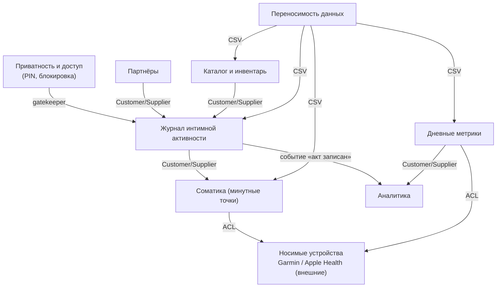

# Bounded Context Map: XDiary

## Контексты

| # | Контекст | Классификация | Роль |
|---|---|---|---|
| 1 | Журнал интимной активности (Activity Journal) | Core Domain | Execution |
| 2 | Партнёры (Partners) | Supporting | Execution |
| 3 | Каталог и инвентарь (Catalog & Inventory) | Supporting | Execution |
| 4 | Соматика — минутные точки (SomaticSeries) | Supporting | Gateway |
| 5 | Дневные метрики (DailyMetrics) | Supporting | Gateway |
| 6 | Аналитика (Analytics) | Supporting | Analysis |
| 7 | Приватность и доступ (Privacy & Access) | Generic | Execution |
| 8 | Переносимость данных (Data Portability) | Generic | Execution |

## Диаграмма

## Связи

| Downstream (потребитель) | Upstream (поставщик) | Тип отношения | Механизм |
|---|---|---|---|
| Журнал | Партнёры | Customer/Supplier | IndexedDB `partners`; ссылка по имени |
| Журнал | Каталог | Customer/Supplier | IndexedDB `catalog`; ссылки по имени |
| Журнал | Соматика (минутные точки) | Customer/Supplier | срез соматики вокруг `startedAt` |
| Аналитика | Журнал | Customer/Supplier | событие «акт записан» (записи) |
| Аналитика | Дневные метрики | Customer/Supplier | дневные тренды (стресс/пульс/сон/HRV) |
| Соматика (минутные точки) | Garmin / Apple Health (внешние) | Anti-Corruption Layer | Garmin API / экспорт Apple Health |
| Дневные метрики | Garmin / Apple Health (внешние) | Anti-Corruption Layer | Garmin API / экспорт Apple Health |
| Перенос данных | Журнал / Соматика (минутные точки) / Дневные метрики / Каталог | Published Language | CSV (общий формат) |
| Все контексты | Приватность и доступ | Gatekeeper | PIN (сквозной) |

## Shared Kernel (общее ядро)

- Идентичность акта: `record.id`, `record.startedAt` (локальное время) — общее для Журнала, Соматики, Дневных метрик и Аналитики.
- Справочник пола (`male`/`female`) и типов оргазмов — общий для Журнала, Партнёров и Каталога.

## Легенда

- **Customer/Supplier** — поставщик задаёт формат, потребитель подстраивается.
- **Anti-Corruption Layer** — изоляция внешних моделей производителей (Garmin без CORS; Apple Health через ручной экспорт).
- **Published Language** — публикуемый формат обмена (CSV).
- **Gatekeeper** — сквозной контроль доступа перед входом в приложение.

## Принцип «1 агрегат = 1 контекст»
Каждый контекст владеет ровно одним агрегатом записи: Record, Partner, CatalogItem, SomaticPoint, DailyMetrics, PinCredential, CsvDocument. Аналитика — read-only проекционный контекст (без агрегата записи).
