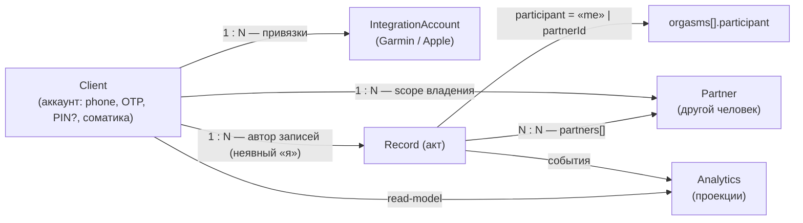

# Карта сущностей и отношений (XDiary)

> **Основание:** бизнес-постановка владельца 2026-11-09: «Клиент и Партнёр — два разных ограниченных
> контекста; клиент содержит инфу о PIN, аккаунтах соматики и т.п.; **я в акте не выбираю себя — я всегда
> в сексе**». Этот документ фиксирует **отношения сущностей** до любого ADR про онбординг
> (ADR-024 остаётся черновиком).

## 1. Кто есть кто

| Сущность | Что это | Владелец данных | Пример |
|---|---|---|---|
| **Client** | аккаунт в приложении: `phone`, OTP, (PIN — см. §5), привязки соматики, настройки | сам пользователь | «я как пользователь» |
| **Partner** | **другой человек** — участник актов: `name`, `gender`, `photo`, `notes` | клиент (scope владения) | «партнёрша» |
| **Record** (акт) | фиксация акта: `partners[]`, `startedAt`, длительность, позиции, аксессуары, оргазмы | клиент (автор) | «вчера, 23:10» |
| **IntegrationAccount** | аккаунт источника соматики (Garmin / Apple Health) | клиент | Garmin Connect |

**Главное различение:** Client — **про аккаунт**, Partner — **про участника акта**. «Я» в акте —
это **автор записи**, а не запись в `partners[]`.

## 2. Отношения

| Отношение | Кардинальность | Ключ | Что это значит |
|---|---|---|---|
| Client → Partner | 1 : 0..N | `partner.clientId` (scope) | у клиента есть свои партнёры; **среди них нет «я»** |
| Client → Record | 1 : 0..N | `record.author = clientId` | автор записи = «я», **не выбирается** |
| Record → Partner | N : N | `record.partners[]` | участники акта кроме «я»; 0 = соло |
| Record → orgasms | — | `participant = "me" \| partnerId` | «я» и партнёр считаются отдельно |
| Client → IntegrationAccount | 1 : 0..N | `clientId` | соматика привязана к аккаунту, не к партнёру |
| Catalog → Partner | нет FK | `FantasyPartner` — свободный текст | каталог **не** ссылается на партнёра по id |

## 3. Инварианты

1. **«Я» никогда не является Partner.** Нет записи партнёра, обозначающей автора; в акте участники =
   автор (неявный) + `partners[]`.
2. `record.partners[]` и `orgasms[].participant` ссылаются **только на других людей**.
3. Partner может **не иметь аккаунта**: второй человек не обязан быть клиентом приложения.
4. Каталог не держит FK на Partner (`FantasyPartner` — текст), поэтому «я» в каталоге не участвует.
5. Соматика привязана к **клиенту**, не к паре и не к партнёру.

## 4. Дельта: где доки расходятся с постановкой

| Место | Сейчас в документах | По постановке | Действие |
|---|---|---|---|
| `BC-Client/02-aggregate-canvas.md` | `Client.LinkedPartnerId` — VO «партнёр-«я»», состояния `Linked`/`Unlinked` | эго-партнёра быть не должно: «я» = автор записи | убрать VO и переходы **после твоего подтверждения** |
| `00-context-map.md:48` | «Клиент → Партнёры: ссылка `clientId` (партнёр-«я»)» | Client → Partners = **scope владения** («мои партнёры»), не «я» | переформулировать |
| `BC-Journal/02-aggregate-canvas.md` | «Участники акта = «я» (владелец, неявный) + `partners[]`» | **совпадает** | без изменений |
| `BC-Partners/02-aggregate-canvas.md` | `Partner(name, photo, gender, notes)`; в реализации добавлен `clientId` | `clientId` = владение, не «я» | уточнить имя/смысл поля |

## 5. Открытые вопросы (нужен ответ владельца — это и есть бизнес-постановка)

1. **PIN:** в доках он в BC-Privacy (ADR-008), ты говоришь «клиент содержит инфу о PIN». Значит ли это,
   что PIN переезжает **внутрь Client** (и Privacy становится частью Client), или Privacy остаётся
   отдельным контекстом-гейтом?
2. **Второй человек:** партнёр **всегда без аккаунта**, или он может стать клиентом (тогда у пары два
   аккаунта и у каждого своё «я»)? От этого зависит, нужен ли `partner.clientId` вообще.
3. **Соматика второго:** если у партнёра нет аккаунта, его Garmin/Apple в приложении не участвует —
   подтверждаешь?
4. **Профиль «я»:** имя/пол «я» — это поля **Client** (нужны ли они вообще в акте?), или «я» в акте
   не отображается и профиль нужен только для приветствия?
5. **Онбординг:** если «я» не сущность — что показываем после входа: пустой журнал сразу, или
   спрашиваем имя/пол (и зачем, если «я» в акте не участвует)?
6. **Аналитика:** метрики «я vs партнёры» нужны (уже возможно через `participant`), или только по
   партнёрам?

## 6. Что этот документ НЕ решает

- Не выбирает модель профиля и экраны онбординга — это ADR-024, он **черновик** и не реализуется.
- Не меняет код и контракты: дельта из §4 вносится только после ответов на §5.
