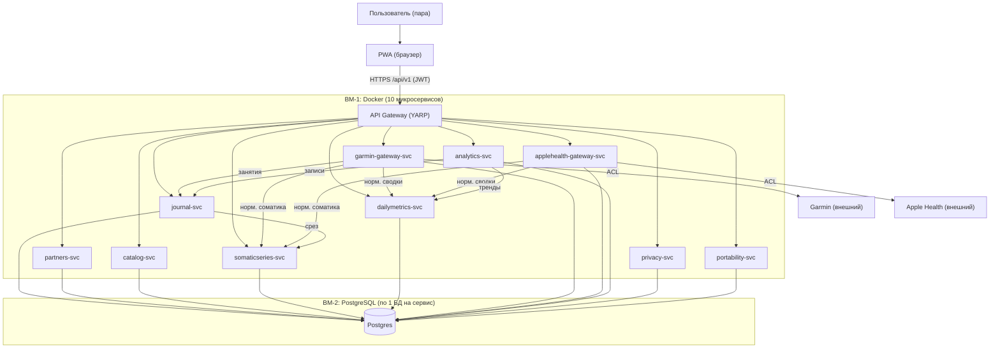

# C4 — Контейнеры (микросервисы)

Принципы: **1 ограниченный контекст = 1 микросервис** (ADR-001), профиль **Single** (ADR-002).

## Состав (10 микросервисов)

| Сервис | Контекст | Агрегат | Профиль |
|---|---|---|---|
| `journal-svc` | Журнал | Record | Single |
| `partners-svc` | Партнёры | Partner | Single |
| `catalog-svc` | Каталог | CatalogItem | Single |
| `somaticseries-svc` | Соматика — минутные точки | SomaticPoint | Single |
| `dailymetrics-svc` | Дневные метрики | DailyMetrics | Single |
| `garmin-gateway-svc` | Шлюз Garmin | GarminSync | Single |
| `applehealth-gateway-svc` | Шлюз Apple Health | AppleImport | Single |
| `analytics-svc` | Аналитика | — (read-only) | Single |
| `privacy-svc` | Приватность и доступ | PinCredential | Single |
| `portability-svc` | Переносимость данных | CsvDocument | Single |

## Профиль Single (на каждый сервис)
- 1 процесс (Cmd + Evt + Qry).
- Command DB = PostgreSQL (Event Sourcing).
- Read DB = та же БД (без отдельной схемы).
- EventBus = InMemory.

## Диаграмма контейнеров

## Замечания
- **Межсервисная связь** — HTTP через шлюз (EventBus в Single — внутри процесса, не кросс-сервисный).
- **Аналитика** — read-only: читает записи и тренды через query-API `journal-svc` и `dailymetrics-svc`.
- **Приватность** (`privacy-svc`) — выпуск/проверка JWT; локальный PIN остаётся на устройстве.
- **Шлюзы Garmin/Apple** — изолируют внешние модели (ACL), отдают нормализованную соматику; занятия → журнал.
