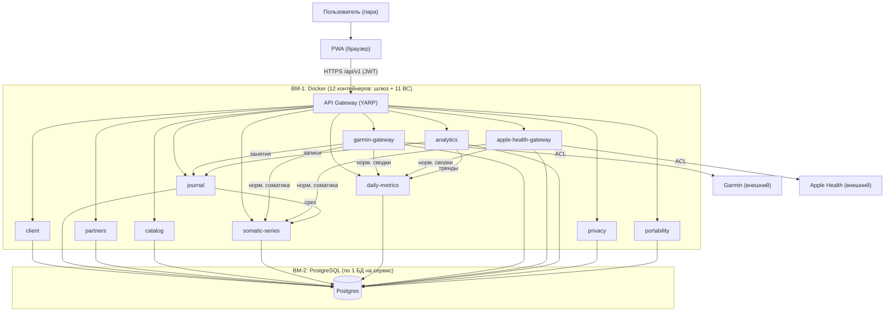

# C4 — Контейнеры (микросервисы)

Принципы: **1 ограниченный контекст = 1 микросервис** (ADR-001), профиль **Single** (ADR-002). Имена сервисов — по домену (MSA, без `-svc`).

## Состав (11 микросервисов BC + шлюз отдельно)

| Сервис | Контекст | Агрегат | Профиль |
|---|---|---|---|
| `client` | Клиент: профиль, идентификация, токены | Client (без агрегата-корня) | Single |
| `journal` | Журнал | Record | Single |
| `partners` | Партнёры | Partner | Single |
| `catalog` | Каталог | CatalogItem | Single |
| `somatic-series` | Соматика — минутные точки | SomaticPoint | Single |
| `daily-metrics` | Дневные метрики | DailyMetrics | Single |
| `garmin-gateway` | Шлюз Garmin | GarminSync | Single |
| `apple-health-gateway` | Шлюз Apple Health | AppleImport | Single |
| `analytics` | Аналитика | — (read-only) | Single |
| `privacy` | Приватность и доступ | PinCredential | Single |
| `portability` | Переносимость данных | CsvDocument | Single |

## Профиль Single (на каждый сервис)
- 1 процесс (Cmd + Evt + Qry).
- Command DB = PostgreSQL (Event Sourcing).
- Read DB = та же БД (без отдельной схемы).
- EventBus = InMemory.

## Диаграмма контейнеров

## Замечания
- **Межсервисная связь** — HTTP через шлюз (EventBus в Single — внутри процесса, не кросс-сервисный).
- **Аналитика** — read-only: читает записи и тренды через query-API `journal` и `daily-metrics`.
- **Приватность** (`privacy`) — выпуск/проверка JWT; локальный PIN остаётся на устройстве.
- **Шлюзы Garmin/Apple** — изолируют внешние модели (ACL), отдают нормализованную соматику; занятия → журнал.

## Шлюз: YARP живёт (проверено 2026-11-10, @AR)

`api-gateway` = **YARP reverse proxy + BFF**, и это **не** «остаток на вывод»: `6-msa/ApiGateway/Program.cs:6-8` (`AddReverseProxy().LoadFromConfig(...)`)
и `:71` (`MapReverseProxy()`). В репозитории `yarp` встречается в **86** файлах.

**Уточнение к `AR-019`:** её посылка «`api-index` после **вывода** YARP» — это **план** (`ADR-030` §5 этап 4), а не факт: YARP **не выведен**.
Поэтому «0 упоминаний YARP в индексе» — истина, но **бессодержательная**: в индексе описаны операции, а не прокси, и YARP там не значился никогда.
