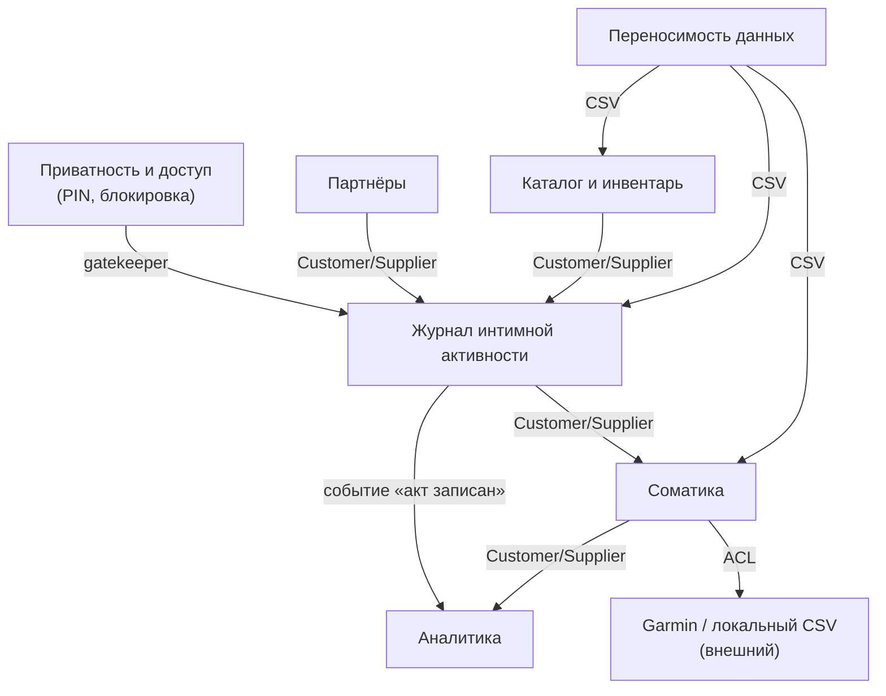

# Bounded Context Map: XDiary

## Контексты

| # | Контекст | Классификация | Роль |
|---|---|---|---|
| 1 | Журнал интимной активности (Activity Journal) | Core Domain | Execution |
| 2 | Партнёры (Partners) | Supporting | Execution |
| 3 | Каталог и инвентарь (Catalog & Inventory) | Supporting | Execution |
| 4 | Соматика (Somatics) | Supporting | Gateway |
| 5 | Аналитика (Analytics) | Supporting | Analysis |
| 6 | Приватность и доступ (Privacy & Access) | Generic | Execution |
| 7 | Переносимость данных (Data Portability) | Generic | Execution |

## Диаграмма

## Связи

| Downstream (потребитель) | Upstream (поставщик) | Тип отношения | Механизм |
|---|---|---|---|
| Журнал | Партнёры | Customer/Supplier | IndexedDB `partners`; ссылка по имени |
| Журнал | Каталог | Customer/Supplier | IndexedDB `catalog`; ссылки по имени |
| Журнал | Соматика | Customer/Supplier | срез соматики вокруг `startedAt` |
| Аналитика | Журнал | Customer/Supplier | событие «акт записан» (записи) |
| Аналитика | Соматика | Customer/Supplier | дневные тренды (стресс/пульс/сон/HRV) |
| Соматика | Garmin (внешний) | Anti-Corruption Layer | прокси на ПК, локальные CSV |
| Перенос данных | Журнал / Соматика / Каталог | Published Language | CSV (общий формат) |
| Все контексты | Приватность и доступ | Gatekeeper | PIN (сквозной) |

## Shared Kernel (общее ядро)

- Идентичность акта: `record.id`, `record.startedAt` (локальное время) — общее для Журнала, Соматики и Аналитики.
- Справочник пола (`male`/`female`) и типов оргазмов — общий для Журнала, Партнёров и Каталога.

## Легенда

- **Customer/Supplier** — поставщик задаёт формат, потребитель подстраивается.
- **Anti-Corruption Layer** — изоляция внешней модели Garmin (нет CORS, формат Garmin).
- **Published Language** — публикуемый формат обмена (CSV).
- **Gatekeeper** — сквозной контроль доступа перед входом в приложение.
