# Карта CI/CD XDiary по типам проверок

Снимок на **2026-11-07 ~00:30** (после серии правок гейтов). Источник фактов: `.github/workflows/*.yml`
(29 workflow), `tools/*.py` (41 гейт с `--selftest`), `9-tests/scripts/*` (60 скриптов),
`6-msa/**/*Tests/*.csproj` (31 тестовый проект) и последние прогоны Actions.

Ниже — **слои** от самых дешёвых/быстрых к самым дорогим. Идея: дефект должен ловиться на самом
раннем слое, где он вообще виден, и никогда не компенсироваться ручным действием (`AGENTS.md` §5.4).

```mermaid
flowchart TD
  PUSH[push / pull_request] --> L0

  subgraph L0["L0 · процессные гейты (секунды)"]
    G1[chat-формат + статусы]
    G2[пути/зоны ролей]
    G3[доки: бюджет, личные пути, токены]
    G4[секреты: значения не печатаются]
    G5[ADR: словарь и структура]
    G6[маркеры конфликта / canon-маркер]
  end

  L0 --> L1

  subgraph L1["L1 · статические каноны контракта (секунды)"]
    C1[api-index ↔ код: 82 операции]
    C2[openapi-реестр: 12 файлов / 80 операций]
    C3[read-model ↔ колонки DDL / маппинг]
    C4[eventstore: регистрация, ready]
    C5[null-paging, service-auth, schema]
  end

  L1 --> L2

  subgraph L2["L2 · unit / domain (минуты)"]
    U1["BC-*/src/*Domain.Tests"]
    U2[ApiGateway.Tests]
  end

  L2 --> L3

  subgraph L3["L3 · интеграционные (минуты)"]
    I1["BC-*/src/*IntegrationTests (моки/EF)"]
    I2[изоляция клиентов: чужой id → 404]
  end

  L3 --> L4

  subgraph L4["L4 · API/контракт на живом контуре (минуты)"]
    A1["*ApiTests (пары: Journal.ApiTests → PartnerSoftDelete)"]
    A2["check_apim_auth: 74/74 + 4/4 via=gravitee"]
    A3["check_cors_entry, check_be093, check_otp_leak"]
  end

  L4 --> D[сборка образа: single-&lt;sha&gt; → GHCR]

  D --> LP{"lock-published\n(все теги из images.lock в GHCR?)"}
  LP -->|rc=0| DEV[deploy-dev → update.sh по lock]
  LP -->|rc≠0| STOP[деплой не едет, печатается список]

  DEV --> L5

  subgraph L5["L5 · смоуки после деплоя (минуты)"]
    S1["smoke-api: /health + канон входа + Journal.ApiTests"]
    S2["smoke-prod-cors: preflight + ACAO"]
    S3["public-probe (schedule), health (schedule)"]
  end

  L5 --> L6

  subgraph L6["L6 · E2E в браузере (десятки минут, ночь)"]
    E1["front-e2e: 29 тестов Playwright"]
    E2["33 spec-гейта (структура/селекторы/фикстуры)"]
  end
```



## Слой за слоем: что проверяется и что уже проходит

### L0 · процессные гейты — все зелёные, кроме одного (@LM)

| проверка | инструмент / workflow | статус |
|---|---|---|
| формат чата, `→ @X`, штампы | `check_status_chat.py`, `chat_lint.py` → `ci-guards: check-chat` | 🟢 в составе `ci-guards` |
| зоны ролей (`ядро`/служебные) | `check_paths.py` → `guard-paths.yml` | 🟢 |
| бюджет инструкций (≤32 КБ/файл, ≤64 КБ сумма) | `check_docs_size.py` → `docs-budget.yml` | 🔴 #711 — `AGENTS.md` > 32 КБ, зона **@LM** |
| доки без личных путей и токенов | `check_rule_docs.py` | 🔴 в том же #711 |
| секреты (значения не печатаются) | `check_secrets.py` → `guard-secrets` | 🔴 rc=1: 7 находок (5 — hex-коммиты/дайджесты, предложение @LM; 2 — `TE-052:63/65` `assign:password`, зона @TE) |
| ADR: статусы по словарю, структура | `check_adr.py`, `check_adr_status.py`, `check_adr_refs.py` | 🟢 (после `fetch-depth: 0`) |
| маркеры конфликта в `.md` | `check_nul.py` | 🟢 `rc=0`, 445 файлов |
| canon-маркер единственный | `check_canon.py` | 🟢 `rc=0`, источник `git ls-files` (634) |
| копии инструментов = манифест | `guard-tools.yml` | 🔴 #232 «Копии совпадают с манифестом» (зона @LM) |

### L1 · статические каноны контракта — зелёные

| проверка | инструмент | статус |
|---|---|---|
| индекс API ↔ код (множества, codes, allow-list) | `check_api_index.py` | 🟢 **82 операции / 82 маршрута, расхождений 0**, `--selftest` 4/4 |
| openapi-реестр (12 файлов) | `check_openapi.py`, `openapi-registry.yml` | 🟢 #179 success |
| поля read-модели ⊆ колонки DDL | `check_readstore_ddl.py` | 🔴 `rc=2` «фильтр сломан» — источник переехал в EF-миграции (`DO-109`) |
| read-model смаплена в контексте | `check_readstore_mapping.py` | 🟢 4 регистрации, 0 немаршенных |
| eventstore: регистрация, готовность | `check_eventstore_registration.py`, `check_eventstore_ready.py` | 🟢 канон 6/6 с fallback |
| `IPaging` не null, `null-paging` | `check_null_paging.py` | 🟢 |
| auth-стек BC (ADR-026) | `check_service_auth.py` | 🟢 6/6 с fallback |
| схема/окружение/порты/хосты | `check_schema.py`, `check_env_drift.py`, `check_ports.py`, `check_env_hosts.py` | 🟢 в составе гейтов |

### L2 · unit / domain — 13 сервисных прогонов, 12 зелёных

`ci-<service>.yml` у каждого BC: `dotnet build` + `dotnet test 6-msa/BC-<X>/src/<X>.*Tests`.

| сервис | последний прогон | статус |
|---|---|---|
| journal | #123 | 🟢 success |
| partners | #117 | 🟢 success |
| catalog | #36 | 🟢 success |
| somatic-series | #37 | 🟢 success |
| daily-metrics | #41 | 🟢 success |
| analytics | #39 | 🟢 success |
| privacy | #33 | 🟢 success |
| portability | #34 | 🟢 success |
| garmin-gateway | #25 | 🟢 success |
| apple-health-gateway | #25 | 🟢 success |
| client | #56 | 🟢 success |
| backend (сводный) | #879 | 🟢 success |
| **api-gateway** | **#18 (04.11)** | 🔴 «Тесты ApiGateway (в папке сервиса)» — старый прогон, не перезапускался |

Покрытие проектами (31 `.csproj`): `Domain.Tests` — 9 BC; `IntegrationTests` — 12 BC;
`ApiTests` — 6 BC (`Analytics`, `Catalog`, `Client`, `DailyMetrics`, `Journal`, `Portability`) + `ApiGateway`.

### L3 · интеграционные — зелёные там, где собираются

Внутри тех же `ci-<service>`: `*IntegrationTests` (моки, EF InMemory недоступен на runner —
поэтому часть проверок сделана на контроллерных тестах). Изоляция клиентов (`BE-084/085`) —
тесты вида `GetByIdAsync(чужой) ⇒ 404`, `clientId` берётся из `sub`, а не из тела.

### L4 · API/контракт на живом контуре

| проверка | инструмент | статус |
|---|---|---|
| канон входа через APIM | `check_apim_auth.py --all --base prod` | 🟢 **`(ii-a) 74/74 · (ii-c) 4/4 · 78 из 82 · via=gravitee · rc=0`**; `--selftest` **27/27** |
| контракт пары Journal→Partners | `Journal.ApiTests` фильтр `PartnerSoftDelete` | ⚠️ зависит от 500 в `partners` (outbox `23505`, `DO`-отчёт) |
| CORS на входе | `check_cors_entry.py` | 🟢 `OPTIONS 204` + `ACAO`, `--selftest` 8/8 |
| stale-поля записи (`BE-093`) | `check_be093_stale_fields.py` | 🟢 на dev: «полей 2 (place, tags) сохранены 2, затерто 0» |
| утечка OTP | `check_otp_leak.py` | 🟢 на проде `rc=0` («OTP-полей 0, разрешено контрактом 1») |
| APIM drift (12 API ↔ 80 операций) | `check_apim_drift.py` → `apim-drift.yml` | 🟢 #2 success (`rc=0`, 12 API = 12 спек, 0 расхождений) |

### Сборка и деплой

| шаг | где | состояние |
|---|---|---|
| образ `single-<sha>` в GHCR | `ci-<service>: docker` (только при зелёных тестах) | 🟢 для 12 сервисов, `api-gateway` — нет |
| `lock-published` | `deploy.yml` (новый job до `deploy-dev`) | 🟢 12/13 опубликовано, `front` — `unverified` (403, деплой через Pages) |
| `lock = реестр` (смешанный набор с провенансом) | `gen_images_lock.py --from-registry` | 🟢 `--verify-registry rc=0`, `--receipt` 13/2/1 |
| `deploy-dev` | `update.sh` по `images.lock` | ⚠️ на dev каталог `/opt/xdiary/7-deploy` был старой версии (`TAG=first`), сейчас правится |
| `deploy-prod` | `deploy.sh` по `images.lock` | ⏸ skipped (ждёт зелёные смоуки) |

### L5 · смоуки после деплоя

| проверка | где | состояние |
|---|---|---|
| `/health` dev и прод | `deploy.yml: smoke-api` | 🟢 dev 200, прод 200 |
| канон входа на проде | `smoke-api` → `check_apim_auth --all` | 🟢 74/74 + 4/4 |
| контракт `PartnerSoftDelete` | `smoke-api` → `Journal.ApiTests` | 🔴 500 в `partners` (outbox) |
| CORS прод | `deploy.yml: smoke-prod-cors` | 🟢 добавлен, локально 204 + `ACAO` |
| публичный вход / живость | `public-probe.yml` #8, `health.yml` #6 | 🟢 success |
| свежесть бэкапов | `backup-check.yml` #2 | 🟢 success |

### L6 · E2E в браузере (ночь, отдельная очередь)

`ci-front.yml`: `spec-gates` (33 гейта по спекам Playwright — структура, селекторы, фикстуры,
отсутствие снов/`|| true`, время-бюджет) + `front-e2e` (29 тестов на стенде, `concurrency` без
`cancel-in-progress`). `ci-front` #883 — **success** (гейты). Последний известный E2E на стенде:
18 failed / 3 skipped / 8 passed — падения в `Before Hooks` (логин/навигация), т.е. среда, а не
утверждения; причина — 500 в `partners` и `when`-404 (сейчас оба адреса в работе).

## Что уже проходит «по-настоящему» (сводка)

- **Процесс и каноны**: 41 гейт с `--selftest`; зелёные — статусы задач, пути ролей, ADR-словарь,
  маркеры конфликта, `canon`-маркер, индекс API (82/82), openapi-реестр, read-model маппинг,
  eventstore-регистрация, auth-стек, null-paging, порты/хосты/схема.
- **Тесты кода**: 12 из 13 сервисных прогонов зелёные (31 тестовый проект: domain + integration +
  api-тесты у 6 BC); `api-gateway` — единственный красный, прогон от 04.11.
- **Контракт на живом проде**: канон входа `74/74 + 4/4`, `via=gravitee`, `rc=0`; CORS `204 + ACAO`;
  APIM drift `12 API = 12 спек`, 0 расхождений; утечка `otpCode` закрыта (`rc=0`).
- **Инфраструктура**: `lock-published` работает, lock собирается из реестра с провенансом,
  `front` помечен `unverified`; публичный вход, живость и бэкапы — зелёные.

## Что красное и почему (чтобы не читалось как «фон»)

| красное | причина | владелец |
|---|---|---|
| `docs-budget` #711 | `AGENTS.md` > 32 КБ; вынести §5.5/§6 в `docs/` | @LM |
| `guard-tools` #232 | «Копии совпадают с манифестом» — манифест копий инструментов | @LM |
| `ci-api-gateway` #18 | старый прогон (04.11), `swagger` 401 / тесты в папке сервиса | @BE/@DO |
| `check_readstore_ddl` | ищет `CREATE TABLE IF NOT EXISTS`, а DDL в EF-миграциях (`DO-109`) | @AR (решение) / @LM (инструмент) |
| `smoke-api` (`PartnerSoftDelete`) | 500 в `partners`: `23505` на `outbox` (неидемпотентная вставка) | @BE |
| `check_secrets` | 5 hex-ложных (коммиты/дайджесты) + 2 `assign:password` в `TE-052` | @LM / @TE |
| `deploy-prod` | skipped, пока `smoke-api`/`smoke-front` красные | ждёт @BE |

## Как прогнать локально (то же, что в CI)

```bash
python tools/check_api_index.py --selftest && python tools/check_api_index.py
python tools/check_nul.py && python tools/check_canon.py
python tools/check_secrets.py --config loop.config.json
python tools/gen_images_lock.py --selftest && python tools/gen_images_lock.py --verify-registry
python 9-tests/scripts/check_apim_auth.py --selftest
python 9-tests/scripts/check_apim_auth.py --all --base https://xdiary-vps1.taile0b6ee.ts.net
python 9-tests/scripts/check_cors_entry.py --base https://xdiary-vps1.taile0b6ee.ts.net
```

## Где это может врать (осознанные ограничения)

1. **«Прогон без шагов — не прогон»**: часть workflow может быть `cancelled` вытеснением; вердикт
   только по прогону, который завершился сам.
2. **`rc=2` = «не измерено»**, а не «ок»: так ведут себя `check_readstore_ddl`, `check_apim_auth`
   без `via=gravitee`, `gen_images_lock --verify-registry` без сети.
3. **`front` не проверяется в GHCR** (403, приватный пакет) — это архитектурное отличие: фронт
   деплоится через Pages; в lock строка помечена `unverified`.
4. **E2E ночью** — на живом стенде; падение в `Before Hooks` чаще означает среду, а не продукт;
   поэтому `front-e2e` отделён от `spec-gates` (структурные гейты быстрые и детерминированные).
